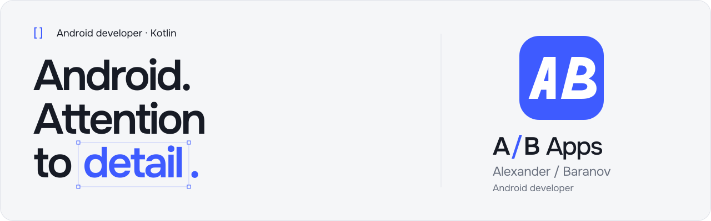
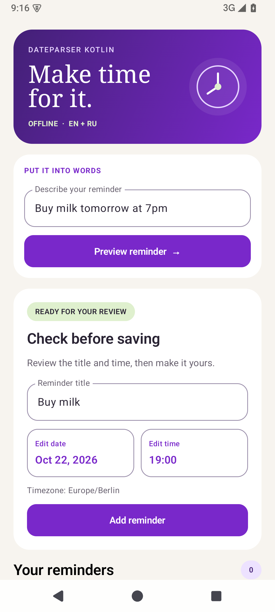
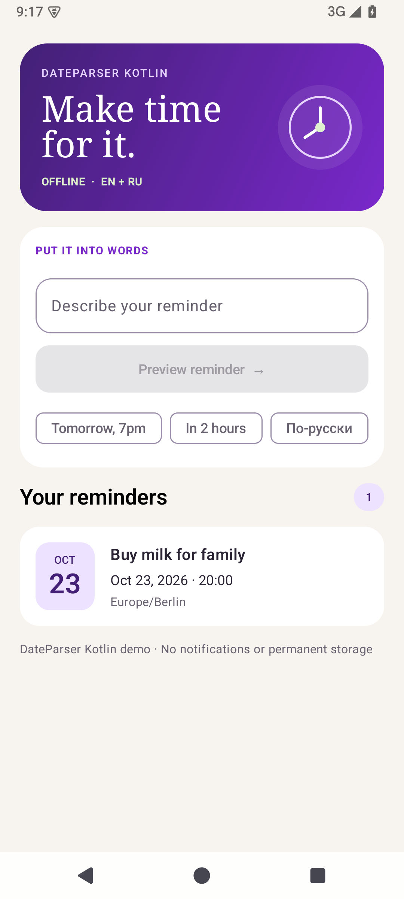
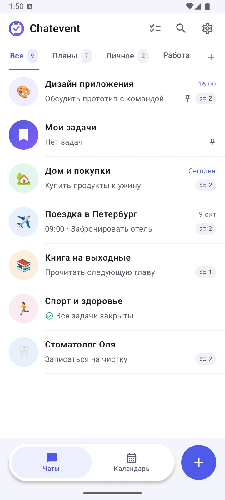
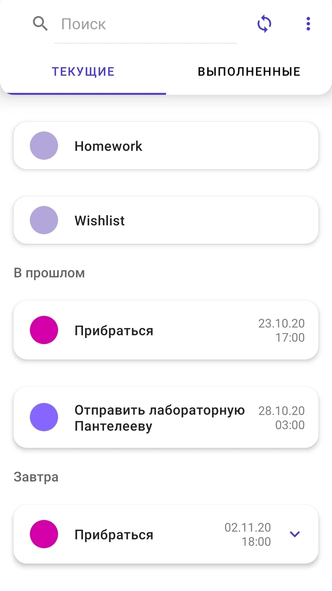

  
  
  
  

Android developer working with **Kotlin**, **Jetpack Compose**, **Kotlin Multiplatform** and the details that make an app feel right.

- **Now:** Android fintech at **Wildberries** - installment payments, financial calculations and reliable UI state.
- **Previously:** **VK ID** - authentication flows and Android integration.
- **Open source:** [**DateParser Kotlin**](https://github.com/Alox1d/dateparser-kotlin), an offline date/time parser published on Maven Central.
- **On my workbench:** **Chatevent**, a commercial planner where tasks live in chats.

`Java` · `Coroutines / Flow` · `Room`

  <a href="https://t.me/Alox1d"><b>Telegram ↗</b></a>
  &nbsp; · &nbsp;
  <a href="https://habr.com/ru/users/alox1d/"><b>Habr ↗</b></a>
  &nbsp; · &nbsp;
  <a href="https://habr.com/ru/companies/vk/articles/780194/"><b>My VK ID article ↗</b></a>

### [DateParser Kotlin ↗](https://github.com/Alox1d/dateparser-kotlin)

*Offline natural-language date and time parsing for Kotlin Multiplatform.*

English and Russian · Android, JVM and iOS.

[Latest release ↗](https://github.com/Alox1d/dateparser-kotlin/releases/latest) · [Documentation ↗](https://alox1d.github.io/dateparser-kotlin/en/) · [KMP demo ↗](https://alox1d.github.io/dateparser-kotlin/en/kmp-reminder-demo/) · [klibs.io ↗](https://klibs.io/project/Alox1d/dateparser-kotlin)

**`Buy milk tomorrow at 7pm` → `Buy milk` + tomorrow at 19:00.**

  
  &nbsp;
  

Use it in `commonMain` with a reference instant, an explicit timezone and US/European date order. The runnable KMP consumer and Android Compose demo show how to review and edit the result before saving. No API keys or network calls.

### Apps

#### Chatevent

A chat-shaped planner: tasks, notes, folders and a calendar in one place.

**Commercial product · In development**  
Private source · Kotlin · Compose · Room · Glance

#### WordNote

Notes, tasks and reminders with English voice input, OCR and date/time extraction.

**Historical graduation project · Huawei Cup 2020 APP student winner**  
Ivanovo State Power Engineering University · Kotlin / Java · SQLite · Huawei HMS

[Source code ↗](https://github.com/Alox1d/wordnote) · [AppGallery ↗](https://appgallery.huawei.com/app/C103198375) · [Video demo ↗](https://www.youtube.com/watch?v=rDJz7HMdjpE)

### Writing & milestones

- **Huawei Cup 2020:** winner of the **APP student category**. [Official Huawei results, March 26, 2021 ↗](https://www.huawei.ru/news/obyavleny-luchshie-razrabotchiki-mobilnykh-prilozheniy-v-ramkakh-sorevnovaniya-huawei-cup-2020/)
- **SmartFlow: a new authentication flow for VK ID** - my article on Android authentication, published in the VK engineering blog on **February 22, 2024**. [Read on Habr (RU) ↗](https://habr.com/ru/companies/vk/articles/780194/)

### Open-source tools

#### [CSPSigner ↗](https://github.com/Alox1d/act-signer)

A Windows PowerShell desktop tool for batch signing files with CryptoPro CSP. Creates detached CAdES-BES signatures without changing the source files, verifies signatures, and avoids signing the same file twice with the selected certificate.

[Download latest release ↗](https://github.com/Alox1d/act-signer/releases/latest) · [Documentation (EN) ↗](https://github.com/Alox1d/act-signer/blob/main/README.en.md)

#### [PCBCalc ↗](https://github.com/Alox1d/PCBCalc)

My 2018 graduation project at Ivanovo Energy College: educational PCB vibration and reliability calculations, with Word export.

Java · 7 calculation/export tests · Original report templates

### Public Android samples

Small Android samples and experiments, from custom drawing to voice recording.

- [**vkvoicenotes**](https://github.com/Alox1d/vkvoicenotes) - Voice recording and playback with Android Views, Room, Dagger, RxJava and ExoPlayer.
- [**CustomViewTest**](https://github.com/Alox1d/CustomViewTest) - Custom Android Views: Canvas drawing, bitmap shaders, XML attributes and saved state.
- [**AndroidCore**](https://github.com/Alox1d/AndroidCore) - Java/Kotlin fundamentals, concurrency, collections, Coroutines/Flow and Handler/Looper experiments.

### Course-based learning

Exercises I followed and adapted while learning Android.

- [VKNewsApp](https://github.com/Alox1d/VKNewsApp) - a learning VK news client with Compose, MVVM, Flow, Dagger, Retrofit and pagination.
- [ComposeAnimations](https://github.com/Alox1d/ComposeAnimations) - Compose animation exercises: content, size, shape, color, alpha and rotation.
- [MVI-Weather-App](https://github.com/Alox1d/MVI-Weather-App) - an unfinished exploration of MVIKotlin, Decompose, Room and Retrofit.

